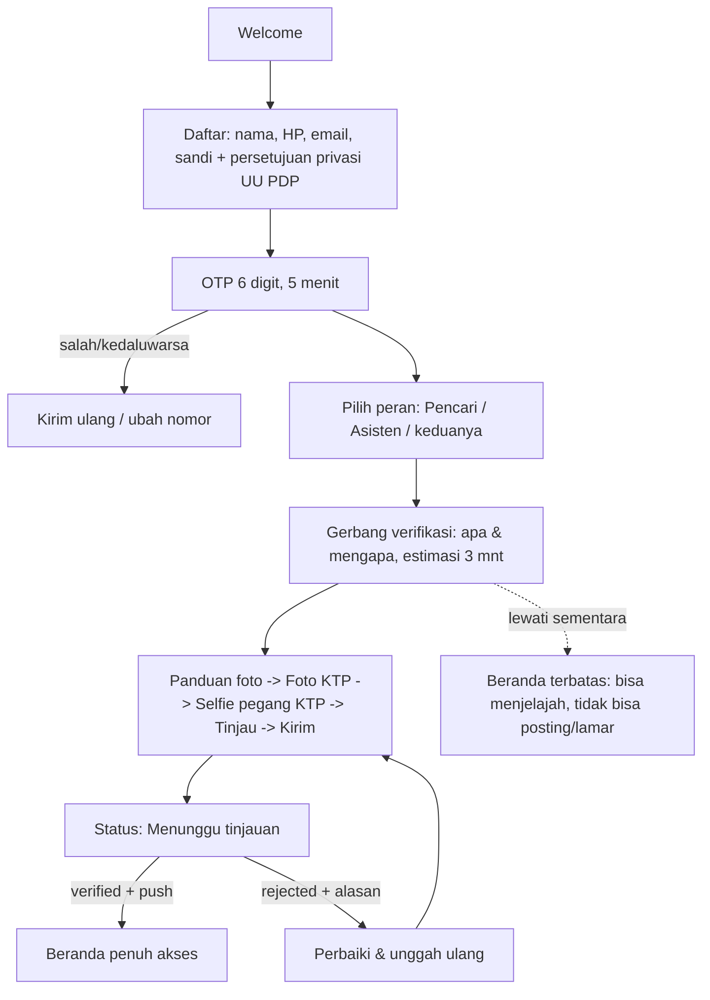
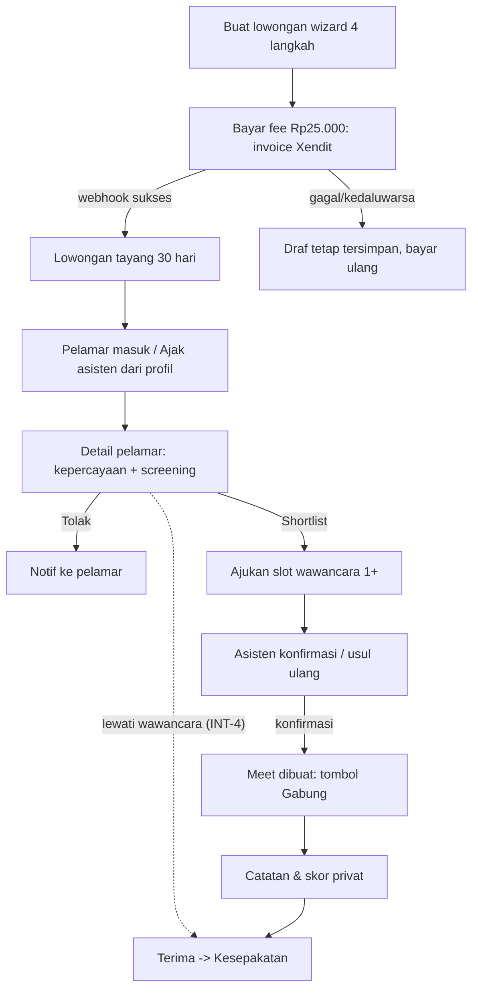
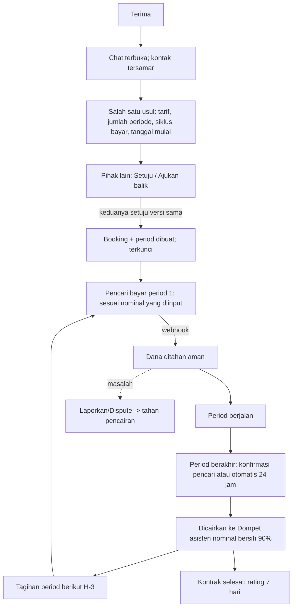
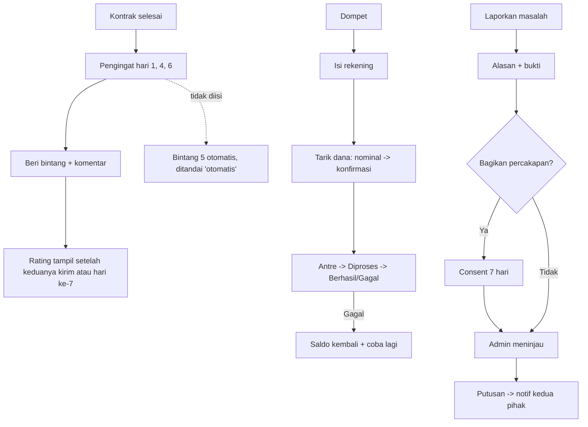

# Full UI & UX Design Brief — Mobile (Flutter, Android + iOS, 1 app 2 role)

> Sumber: [[PRD-v1]] dan [[Spec-Teknis-v1]] (endpoint & state machine -> state UI). Tokens lengkap ada di brief Web: [[02-UIUX-Brief-Web]] §3 (sumber tunggal). Bagian §3 di sini hanya ringkasan + pemetaan Flutter. Bila berbeda, **dokumen Web menang**.
> Nama produk TBD -> `[NamaProduk]`. 🟡 = keputusan terbuka.

## 1. Tujuan & prinsip

| # | Tujuan | Ukuran (target 90 hari, PRD §2) |
|---|---|---|
| T1 | Pengguna baru lulus verifikasi KTP+selfie tanpa bantuan | >= 85% selesai unggah dalam 1 sesi; median < 4 mnt |
| T2 | Pencari menyaring pelamar dengan yakin (profil kepercayaan jelas) | >= 30% lowongan jadi booking |
| T3 | Uang terasa aman & dapat dilacak oleh kedua pihak | 0 pertanyaan "uang saya di mana" tanpa jawaban di layar; bayar sukses >= 90% percobaan |
| T4 | Kontak/transaksi tetap di dalam app | pelanggaran penyamaran diblok 100% di server; laporan leakage rendah |
| T5 | Dapat dipakai pengguna literasi digital rendah (ART, supir, 22-55 th) di Android entry-level | tugas inti selesai >= 80% oleh peserta uji 45+ |

**Prinsip**

1. **Satu langkah, satu tujuan.** Wizard pendek; layar tidak meminta lebih dari satu keputusan.
2. **Status selalu terlihat.** Dari lamaran hingga dana, pengguna selalu tahu "ada di mana, apa berikutnya, siapa yang bergerak" (kartu *Langkah berikutnya*).
3. **Uang jelas.** Pencari melihat total yang dibayar, asisten melihat dana yang diterima (nominal bersih) sebelum dan sesudah bayar; potongan layanan 10% dihitung server di sisi asisten dan tidak ditampilkan sebagai baris biaya; istilah awam ("Dana ditahan aman").
4. **Privasi sebagai fitur.** Penyamaran kontak, persetujuan berbagi chat, dan layar KTP aman dijelaskan *di tempatnya*, bukan di kebijakan.
5. **Role tidak membingungkan.** Role aktif terlihat permanen; pindah role = 1 ketukan, tanpa logout.
6. **Bahasa sederhana + ikon berlabel.** Tidak ada ikon tanpa teks pada aksi penting.
7. **Tahan jaringan buruk.** Offline-tolerant: draf tersimpan, unggahan dapat dilanjutkan, tidak ada kehilangan input.

## 2. Arah visual — "Buku Kas Rumah" (ringkas; alasan lengkap di Web §2)

> **Catatan perubahan (2026-10-10):** arah visual diubah mengikuti contoh UI aplikasi lowongan kerja dari user: terang, bersih, airy, biru langit dengan glow gradien di header, kartu putih radius 16, tombol penuh radius 14, ilustrasi flat vektor (biru + aksen oranye), Pencari = biru dan Asisten = teal. Seluruh isi §2-§3 di bawah (krem, indigo, soga, Fraunces/serif) digantikan oleh [10-Design-System-App](10-Design-System-App.md) v2; bagian lain dokumen ini (alur, status, trust, aksesibilitas) tetap berlaku.

Kertas hangat + tinta indigo + segel soga. **Peran** dibedakan lewat tint: **Pencari = indigo (`primary`)**, **Asisten = soga (`accent`)** pada indikator bottom nav, chip peran, dan header beranda. Mengapa: kesalahan peran (mis. melamar sebagai pencari) dicegah visual, bukan hanya teks. **Segel verifikasi** adalah elemen khas yang muncul di profil, kartu pelamar, dan chat. **Garis ledger** (timeline berpetak) menampilkan period & dana. Foto = foto profil asli pengguna; tidak ada ilustrasi orang generik.

## 3. Design tokens (ringkas; nilai identik dengan Web §3)

### 3.1 Warna (Light / Dark)

| Token | Light | Dark |
|---|---|---|
| `bg.canvas` | `#FAF7F2` | `#15130F` |
| `bg.surface` | `#FFFFFF` | `#1E1B16` |
| `bg.sunken` | `#F3EEE6` | `#100E0B` |
| `bg.raised` | `#FFFFFF` | `#27231D` |
| `border.subtle` / `border.strong` | `#E2D9CC` / `#8C8070` | `#3A342B` / `#7A6F60` |
| `text.primary` / `muted` / `subtle` | `#1F1B16` / `#5A5146` / `#6F6558` | `#F2EDE4` / `#BDB3A4` / `#A39989` |
| `primary` / `container` / `on` | `#244C7C` / `#E4ECF7` / `#FFFFFF` | `#9DBDEB` / `#1F3350` / `#0F2542` |
| `accent` (soga) / `container` | `#9A4E1C` / `#F8E9DC` | `#E8A472` / `#3A2616` |
| `success` / `container` | `#1B6E45` / `#E3F2EA` | `#6FCB9A` / `#143323` |
| `warning` / `container` | `#8A5200` / `#FFF1D6` | `#F0B95B` / `#3A2B0E` |
| `danger` / `container` | `#B3261E` / `#FBE5E3` | `#FF9A92` / `#4A1A17` |
| `focus.ring` | `#244C7C` | `#9DBDEB` |
| `scrim` | `rgba(31,27,22,.48)` | `rgba(0,0,0,.64)` |

Kontras terhitung >= 4,5:1 (teks) dan >= 3:1 (kontrol/ikon) pada kedua tema. Status = warna + ikon + teks.

### 3.2 Tipografi
Fraunces (judul besar: layar, nominal hero) · IBM Plex Sans (UI) · IBM Plex Mono (uang kecil, ID, kode OTP) — dibundel sebagai aset (bukan unduh runtime; hemat data & offline). Skala `sp` mengikuti text scaling sistem:

| Token | sp / lh | Pakai |
|---|---|---|
| `display` | 32/40 | nominal hero dompet, sapaan beranda |
| `h1` | 26/34 | judul layar |
| `h2` | 20/28 | judul seksi |
| `h3` | 18/26 | judul kartu |
| `body` | **16/24** | isi default |
| `body-sm` | **14/20** (minimum) | metadata |
| `label` | 14/20 medium | tombol, label field |
| `mono` | 14/20 | uang kecil, ID |
| `caption` | 12/16 | hanya non-esensial |

### 3.3 Spacing, radius, elevasi, ikon
Spacing basis 4: `0,2,4,8,12,16,20,24,32,40,48,64` · margin layar horizontal 16 (>= 600 dp: 24). Radius: `xs 4` · `sm 8` (tombol/input) · `md 12` (kartu) · `lg 20` (bottom sheet atas) · `full`. Elevasi: `e0` · `e1` kartu (border + bayangan tipis) · `e2` sheet/menu · `e3` dialog; dark: permukaan lebih terang, tanpa bayangan. Ikon Lucide (padanan Flutter `lucide_icons_flutter`, fallback Material Symbols Outlined) 24 dp, stroke 1,75; satu set saja.

### 3.4 Motion
`instant 100 · fast 160 · base 240 · slow 360 ms`; `standard (.2,0,0,1)`, `enter (.05,.7,.1,1)`, `exit (.3,0,.8,.15)`. Hanya transform/opacity. Hormati `MediaQuery.disableAnimations` / reduce motion sistem.

### 3.5 Pemetaan Flutter

| Token | Implementasi |
|---|---|
| Warna, spacing, radius, motion | `ThemeExtension<AppTokens>` + `ColorScheme` Material 3 (`primary`, `secondary=accent`, `error`, `surface`, `surfaceContainer`) dibangun dari tabel §3.1; tidak memakai `ColorScheme.fromSeed` mentah |
| Tipografi | `TextTheme` kustom dari tabel; `textScaler` sistem dibiarkan; clamp 0,85-2,0 pada komponen sensitif tata letak |
| Tema | `ThemeMode.system` + override di Akun; transisi tema 160 ms |
| Komponen | Satu pustaka `app_ui/` di atas widget Material 3; varian platform lewat `.adaptive` (§12.2) |
| Status chip | `StatusChip(domain, status)` memetakan enum backend ke ikon/warna/teks (Web §3.5) |

## 4. Persona & job-to-be-done

| Persona | Profil | JTBD | Titik sakit |
|---|---|---|---|
| **Bu Rina, Pencari** (36, karyawan Jakarta/Bandung, dua anak, iPhone/Android menengah) | Butuh pengasuh anak terpercaya cepat; waktu sempit | "Saat saya perlu pengasuh, saya ingin cepat membandingkan pelamar yang sudah terbukti jujur dan membayar dengan aman, agar anak saya aman dan saya tidak tertipu." | Takut penipuan; tak tahu cara menilai; ribet bayar; asisten minta uang di luar app |
| **Pak Hendra, Pencari lansia/pemilik** (55, Yogyakarta, mencarikan perawat lansia untuk orang tua) | Literasi digital sedang, teks kecil sulit dibaca | "Saya ingin tahu setiap langkah dengan teks besar dan jelas." | Layar padat, istilah asing |
| **Siti, Asisten ART/pengasuh** (29, Surabaya, Android entry-level RAM 3 GB, data terbatas, pernah ditipu calo) | Mau kerja jelas, dibayar tepat waktu | "Saat saya melamar, saya ingin tahu pencari jujur dan gaji pasti dibayar, agar saya tidak kerja gratis." | Takut data KTP bocor; bingung verifikasi; tak paham potongan fee |
| **Mas Joko, Asisten supir/tukang kebun** (42, literasi rendah, lebih suka suara/ikon) | Pernah pakai WA saja | "Saya ingin melamar dengan sedikit mengetik." | Mengetik panjang; istilah teknis |
| **Peran ganda** (Siti kadang merekrut perawat untuk ibunya) | 1 akun, 2 peran | "Saya ingin pindah peran tanpa daftar lagi." | Lupa sedang di peran apa |

## 5. Information architecture & navigasi

### 5.1 Struktur

```
Auth: Welcome -> Daftar -> OTP -> Pilih peran -> [Gerbang Verifikasi] -> Beranda
Shell (top app bar: logo/judul, chip peran, lonceng, avatar -> tab Profil)
├─ PENCARI  (bottom nav 5)
│   ├─ Beranda        : Langkah berikutnya, lowongan aktif, kontrak berjalan
│   ├─ Cari           : Cari asisten (filter) -> Profil asisten -> Ajak
│   ├─ Pekerjaan      : segmen [Lowongan | Kontrak]
│   │     Lowongan -> Buat/Detail -> Pelamar -> Detail pelamar -> Wawancara -> Kesepakatan
│   │     Kontrak  -> Detail booking -> Period -> Bayar/Konfirmasi/Batal/Dispute -> Rating
│   ├─ Pesan          : Percakapan
│   └─ Profil (M-24)  : /s/profile
├─ ASISTEN  (bottom nav 5)
│   ├─ Beranda        : Langkah berikutnya, rekomendasi lowongan, kontrak berjalan
│   ├─ Lowongan       : Cari lowongan (filter) -> Detail -> Lamar
│   ├─ Pekerjaan      : segmen [Lamaran | Kontrak]
│   ├─ Pesan
│   └─ Profil (M-24)  : /a/profile; Dompet (Saldo -> Tarik dana -> Riwayat; Rekening) dibuka dari sini
└─ Isi tab Profil (kedua peran): foto profil (unggah/ganti/hapus), Profil, Verifikasi & SKCK, Ganti peran, Notifikasi, Rekening, Privasi, Perangkat, Tema, Bantuan, Keluar
Global: Notifikasi (lonceng), Laporkan (profil asisten, chat, detail kontrak, rating)
```

Aturan: bottom nav 4-5 item berikon+label; tab tetap saat masuk layar detail turun (back stack per tab); tidak ada hamburger; FAB tunggal hanya pada "Pekerjaan > Lowongan" (Pencari: "Buat lowongan"). Deep link dari push langsung membuka layar terkait (NTF-1) dan mengganti peran otomatis bila notifikasi milik peran lain (dengan snackbar "Beralih ke peran Asisten").

### 5.2 Ganti peran (AUTH-2)
Chip peran di app bar -> bottom sheet "Gunakan sebagai": Pencari / Asisten (+ "Tambah peran" bila belum). Setelah pindah: transisi 240 ms, bottom nav & tint berubah, haptic ringan, toast "Sekarang sebagai Asisten". Peran baru yang belum terverifikasi memunculkan gerbang verifikasi (verifikasi dipakai bersama: bila sudah `verified`, langsung lolos).

## 6. Alur pengguna utama (mengikuti PRD)

### 6.1 Onboarding -> verifikasi (AUTH-1/2, VER-1)


### 6.2 Pencari: lowongan -> seleksi -> wawancara (LST-1..3, APP, INT)


### 6.3 Asisten: lamar (APP-1, VER-3)
```mermaid
flowchart TD
  A[Cari lowongan] --> B[Detail lowongan]
  B --> C{Wajib SKCK?}
  C -- Ya, belum ada --> D[Unggah SKCK -> menunggu tinjauan admin] --> C
  C -- Ya, terverifikasi / Tidak --> E[Form lamar: pesan, tarif usulan, jawab screening]
  E --> F[Kirim -> status Dilamar]
  F --> G[Tarik lamaran (sebelum diterima)]
```

### 6.4 Chat -> kesepakatan -> bayar -> selesai (CHT, BKG, PAY)


### 6.5 Rating & payout & dispute (RAT, PAY-6, PRV-2/3)


## 7. Pola state yang konsisten (berlaku semua layar)

| State | Pola |
|---|---|
| Loading | Skeleton sesuai bentuk; tombol aksi menampilkan spinner kecil & dinonaktifkan (cegah ganda ketuk); pull-to-refresh pada daftar |
| Empty | Ikon garis 48 dp + judul 1 baris + penjelasan 1 kalimat + 1 tombol aksi (contoh §13); dibedakan "belum ada" vs "hasil kosong karena filter" |
| Error (jaringan) | Kartu inline "Gagal memuat" + Coba lagi; error API menampilkan `error.message` Indonesia dari server + kode kecil; field error di bawah field, fokus pindah ke field pertama bermasalah |
| Offline | Banner tipis atas "Anda sedang offline"; data tersimpan terakhir tampil (cap "diperbarui 14:02"); aksi tulis diberi antrian untuk draf/chat (pesan "Belum terkirim - ketuk untuk ulangi"); aksi uang/verifikasi diblok dengan penjelasan |
| Izin ditolak (OS) | Layar penjelas *sebelum* prompt OS (pre-permission), lalu bila ditolak: kartu "Izin kamera dimatikan" + tombol "Buka Pengaturan" + alternatif (unggah dari galeri) |
| Akses ditolak (403) | "Selesaikan verifikasi untuk menggunakan fitur ini" + tombol ke Gerbang Verifikasi (403 `verified`) |
| Konflik (409) | Dialog "Data sudah berubah (mis. lamaran sudah ditutup)" + Muat ulang |
| Sesi habis (401) | Kembali ke Login, draf & tujuan dipulihkan setelah masuk |
| Throttle (429) | Pesan sabar + hitung mundur (OTP) |

Singkatan di tabel layar: **L** loading · **E** empty · **X** error · **O** offline · **P** izin OS ditolak · **403/409** seperti di atas. Hanya state yang *berbeda dari standar* ditulis eksplisit.

## 8. Daftar layar

### 8.1 Auth & onboarding

| ID | Layar | Tujuan | Komponen | Data/API | Aksi | State khusus | Req |
|---|---|---|---|---|---|---|---|
| M-01 | Welcome | Janji nilai, masuk/daftar | Logo, 3 butir nilai (verifikasi, dana aman, privasi chat), tombol Daftar/Masuk | - | Daftar, Masuk | O: tetap tampil | AUTH-1 |
| M-02 | Daftar | Membuat akun | Field nama, HP (+62), email, sandi (kekuatan), checkbox persetujuan privasi + tautan | `/auth/register` | Lanjut | X: duplikat HP/email (field-level); sandi lemah; O: tombol nonaktif | AUTH-1, §9 Spec |
| M-03 | OTP | Verifikasi HP | 6 kotak (auto-advance, auto-fill SMS bila tersedia), hitung mundur 5 mnt, Kirim ulang | `/auth/otp/send,verify` | Verifikasi, Kirim ulang, Ubah nomor | X: salah (getar + pesan); kedaluwarsa; 429 setelah 5 percobaan/jam (hitung mundur) | AUTH-1 |
| M-04 | Pilih peran | Menentukan peran awal | 2 kartu besar (Cari asisten / Saya asisten) + "Keduanya" (checkbox), penjelasan 1 baris | `/me/roles` | Lanjut | - | AUTH-2 |
| M-05 | Masuk | Login | Field HP/email + sandi, Lupa sandi, biometrik lokal opsional 🟡 | `/auth/login` | Masuk | X: kredensial salah (pesan generik); akun disuspend: layar penjelas + kontak bantuan | AUTH-3 |
| M-06 | Lupa & reset sandi | Pemulihan | Langkah: HP/email -> OTP -> sandi baru | `/auth/password/*` | Kirim, Simpan | 429 | AUTH-3 |

### 8.2 Verifikasi (VER-1/3)

| ID | Layar | Tujuan | Komponen | Data/API | Aksi | State khusus | Req |
|---|---|---|---|---|---|---|---|
| M-10 | Gerbang verifikasi | Menjelaskan apa & mengapa | Segel besar, 3 langkah (KTP, Selfie, Kirim), jaminan privasi ("Hanya dipakai untuk verifikasi, tersimpan terenkripsi"), estimasi waktu | `/verification` | Mulai, Nanti dulu | Sudah verified: lewati otomatis | VER-1 |
| M-11 | Panduan foto | Hasil foto bagus pertama kali | Ilustrasi garis 3 contoh benar/salah (terang, tanpa pantulan, semua sudut terlihat) | - | Siap | - | VER-1 |
| M-12 | Foto KTP | Menangkap KTP | Kamera dengan bingkai KTP, deteksi tepi/kecerahan ringan, tombol rana besar, "Pilih dari galeri" 🟡, **layar aman** (§10.4) | Kamera lokal | Ambil, Ulangi | **P:** kartu izin kamera + Buka Pengaturan + galeri; X: gambar buram (saran ulang); file > 5 MB dikompres otomatis | VER-1 |
| M-13 | Selfie + KTP | Mencocokkan wajah | Kamera depan, bingkai wajah+KTP, instruksi "pegang KTP di samping wajah" | Kamera | Ambil, Ulangi | P, X seperti M-12 (galeri **tidak** diizinkan 🟡) | VER-1 |
| M-14 | Tinjau & kirim | Konfirmasi sebelum unggah | Pratinjau 2 foto (zoom), field nomor KTP (mask, validasi 16 digit), centang "Data benar milik saya", progress unggah | `POST /verification` | Kirim, Ulangi foto | X: unggah gagal -> Lanjutkan (resume) tanpa foto ulang; O: antre unggah; selesai: file lokal dihapus | VER-1 |
| M-15 | Status verifikasi | Pantau hasil | Segel + status (Menunggu / Terverifikasi / Ditolak), alasan tolak jelas + tips, tombol Unggah ulang, estimasi waktu "biasanya < 1x24 jam" 🟡 | `/verification` (+ push) | Unggah ulang, Ke beranda | `rejected`: kartu danger + alasan; duplikat NIK: pesan "Hubungi bantuan" | VER-1/2 |
| M-16 | SKCK | Melengkapi syarat lowongan | Unggah (kamera/PDF/galeri), status SKCK, catatan "dapat dipakai ulang di lamaran lain" | `/me/skck` | Unggah, Ganti | pending/verified/rejected + alasan; file > 5 MB / format salah: pesan jelas | VER-3 |

### 8.3 Shell umum

| ID | Layar | Tujuan | Komponen | Data/API | Aksi | State khusus | Req |
|---|---|---|---|---|---|---|---|
| M-20 | Beranda Pencari | Fokus tugas berikutnya | Kartu **Langkah berikutnya** (mis. "3 pelamar baru", "Tagihan period 2 jatuh tempo 12 Okt"), lowongan aktif (status chip), kontrak berjalan (garis ledger mini), tombol Buat lowongan | `/me/listings`, `/bookings`, `/notifications` | Ketuk kartu -> layar terkait | E: pengguna baru -> ajakan "Buat lowongan pertama" + "Cari asisten"; belum verified: banner Verifikasi | LST, NTF-1 |
| M-21 | Beranda Asisten | Peluang & tugas | Langkah berikutnya (jadwal wawancara, tagihan dikonfirmasi), lowongan cocok (kota+kategori), kontrak berjalan, kartu kelengkapan profil (%) | `/listings`, `/me/applications`, `/bookings` | idem | E: profil belum lengkap -> CTA lengkapi | PRO-1 |
| M-22 | Ganti peran | Beralih | Bottom sheet 2 opsi, peran aktif bertanda | `/me/switch-role` | Pilih | Peran belum ada: "Tambah peran" | AUTH-2 |
| M-23 | Notifikasi | Pusat info | Daftar dikelompokkan (Hari ini/Sebelumnya), titik belum dibaca, ikon per jenis, "Tandai semua dibaca" | `/notifications` | Buka (deep link), Tandai | E: "Belum ada notifikasi"; P: banner "Aktifkan notifikasi" bila izin push ditolak | NTF-1 |
| M-24 | Akun & pengaturan | Pusat kendali | Profil ringkas+segel, Verifikasi & SKCK, Rekening bank, Peran, Tema (Sistem/Terang/Gelap), Perangkat masuk (cabut token), Privasi, Bantuan, Keluar | `/me`, `/me/devices` | Tiap item | Keluar: konfirmasi | AUTH-2/3 |
| M-25 | Pusat privasi | Transparansi data | "Siapa dapat melihat apa" (tabel sederhana per data: profil, kontak, chat, KTP, catatan wawancara), riwayat persetujuan berbagi chat, versi persetujuan UU PDP, minta hapus data 🟡 | `/reports`, persetujuan | Cabut persetujuan (bila masih aktif), Ajukan hapus | E: belum ada riwayat | PRV-1..4 |
| M-26 | Perangkat masuk | Keamanan akun | Daftar perangkat, terakhir aktif, Cabut | `/me/devices` | Cabut | Cabut perangkat ini = keluar | AUTH-3 |

### 8.4 Pencari

| ID | Layar | Tujuan | Komponen | Data/API | Aksi | State khusus | Req |
|---|---|---|---|---|---|---|---|
| M-30 | Cari asisten | Menemukan kandidat | Bar cari, chip kategori, tombol Filter (kota, tarif, periode, rating), daftar kartu asisten (foto, nama, segel, kategori, kota, ★ rating (n), tarif) | `/assistants` | Buka profil, Filter | E: "Belum ada asisten yang cocok. Coba perluas kota atau tarif." [Reset]; paginasi infinite dengan loading footer; 403: perlu verified | LST-4 |
| M-31 | Profil asisten | Menilai & mengajak | Foto, nama, **segel Terverifikasi**, lencana SKCK 🟡, rating+jumlah, pekerjaan selesai, pengalaman, keahlian, tarif, ketersediaan, ulasan (`revealed`), **kontak tersamar** | `/assistants/{id}`, `/users/{id}/reviews` | Ajak, Laporkan (menu) | Kontak: baris "Nomor HP - disembunyikan sampai pembayaran" dengan ikon gembok; ulasan otomatis berlabel "Penilaian otomatis" | PRO-2 |
| M-32 | Ajak asisten | Mengundang ke lowongan | Pilih lowongan `open` (atau Buat baru), pesan pendek | `/assistants/{id}/invitations` | Kirim ajakan | E: belum ada lowongan -> Buat lowongan; sudah diajak: tombol nonaktif | APP-1 |
| M-33 | Buat lowongan (wizard 4 langkah) | Menyusun kebutuhan | 1 Kategori & judul · 2 Deskripsi, kota/area · 3 Periode (jenis, jumlah, tanggal mulai), budget (rentang rupiah), toggle Wajib SKCK · 4 Pertanyaan screening (maks 5 🟡) · Ringkasan; progress langkah; simpan draf otomatis | `POST /listings` | Lanjut/Kembali, Simpan draf, Lanjut ke pembayaran | Validasi per langkah; keluar di tengah: konfirmasi "Simpan draf?"; budget min>maks: error field | LST-1 |
| M-34 | Bayar fee lowongan | Menayangkan | Ringkasan: "Biaya pasang Rp25.000 - tayang 30 hari", pernyataan jelas (tidak dikembalikan jika tidak ada kecocokan 🟡), tombol Bayar -> halaman Xendit (WebView/browser) -> deep link kembali | `POST /listings/{id}/pay` | Bayar | Status: menunggu / berhasil (tayang, tanggal berakhir) / gagal / kedaluwarsa; O: blok | LST-2 |
| M-35 | Lowongan saya | Kelola | Daftar kartu dengan status chip (draf, menunggu bayar, tayang, terisi, ditutup, kedaluwarsa) + sisa hari + jumlah pelamar | `/me/listings` | Buka, Tutup | E: "Belum ada lowongan" + Buat; swipe tidak dipakai untuk aksi destruktif | LST-3 |
| M-36 | Detail lowongan (pencari) | Memantau pelamar | Ringkasan, daftar pelamar (foto, segel, rating, tarif usulan, status), filter status, menu Tutup lowongan | `/listings/{id}/applications` | Buka pelamar, Tutup | E: "Belum ada pelamar. Lowongan Anda tayang sampai 8 Nov."; `filled`: banner ke kontrak | LST-3, APP-2 |
| M-37 | Detail pelamar | Memutuskan | **Kartu kepercayaan** (segel, SKCK, rating, pekerjaan selesai), pesan lamaran, jawaban screening (hanya pencari), tarif usulan, aksi Shortlist/Tolak, Ajukan wawancara, Terima; `Lewati wawancara` bila diizinkan | `/applications/{id}` | Shortlist, Tolak (alasan opsional), Ajukan wawancara, Terima | Status chip alur Application; konfirmasi Tolak; 409 bila pelamar menarik | APP-2, INT-4 |

### 8.5 Asisten

| ID | Layar | Tujuan | Komponen | Data/API | Aksi | State khusus | Req |
|---|---|---|---|---|---|---|---|
| M-40 | Profil asisten (edit) | Membangun kredibilitas | Foto, kategori (>=1), pengalaman, keahlian (chip), tarif & tipe periode, kota, ketersediaan; pratinjau "Begini pencari melihat Anda"; meter kelengkapan | `PUT /me/assistant-profile` | Simpan | Wajib: kategori & kota; belum verified: banner "Profil tampil publik setelah terverifikasi" | PRO-1 |
| M-41 | Cari lowongan | Menemukan pekerjaan | Seperti M-30 untuk lowongan; kartu: judul, kategori, kota, budget, periode, pencari (segel), ★, sisa hari, ikon SKCK | `/listings` | Buka, Filter | E: "Belum ada lowongan yang cocok."; sudah dilamar: lencana "Sudah dilamar" | LST-4 |
| M-42 | Detail lowongan | Menilai tawaran | Deskripsi, budget, periode, tanggal mulai, syarat (SKCK), profil pencari (segel, rating), tombol Lamar | `/listings/{id}` | Lamar, Simpan 🟡, Laporkan | **SKCK terkunci:** tombol berubah "Unggah SKCK untuk melamar" (ikon gembok, penjelasan); sudah lamar: "Lihat lamaran"; lowongan ditutup/kedaluwarsa: nonaktif + alasan | VER-3, APP-1 |
| M-43 | Form lamar | Mengirim lamaran | Pesan (templat singkat bisa dipilih), tarif usulan (rupiah, default tarif profil), jawaban screening (pilihan/ketik pendek), pratinjau | `POST /listings/{id}/applications` | Kirim | X: 422 per field; 409 sudah ada lamaran aktif; draf tersimpan | APP-1 |
| M-44 | Pekerjaan > Lamaran | Memantau lamaran | Daftar + status chip (Dilamar, Masuk daftar pendek, Wawancara dijadwalkan, Sudah diwawancara, Diterima, Ditolak, Ditarik) + undangan masuk (bagian terpisah) | `/me/applications` | Buka, Tarik | E: "Belum ada lamaran. Cari lowongan." | APP-1 |
| M-45 | Detail lamaran | Tahu langkah berikutnya | Garis status, kartu Langkah berikutnya (mis. "Konfirmasi jadwal wawancara"), tombol Tarik lamaran (sebelum diterima), Chat | `/applications/{id}` | Tarik (konfirmasi), Konfirmasi wawancara | Ditolak: pesan hormat tanpa alasan rinci | APP-1 |

### 8.6 Wawancara

| ID | Layar | Tujuan | Komponen | Data/API | Aksi | State khusus | Req |
|---|---|---|---|---|---|---|---|
| M-50 | Ajukan slot (pencari) | Menawarkan waktu | Pemilih tanggal/jam (adaptif), tambah hingga 3 slot, zona WIB, catatan singkat | `POST /applications/{id}/interviews` | Kirim | Slot lampau diblok | INT-1 |
| M-51 | Konfirmasi slot (asisten) | Menjawab | Daftar slot dengan radio, Konfirmasi / Usulkan waktu lain | `/interviews/{id}/confirm`, `/reschedule` | Konfirmasi, Usul ulang | X **502 `MEET_CREATE_FAILED`**: "Tautan wawancara belum dapat dibuat. Lamaran Anda aman. Coba lagi." [Coba lagi] (interview tetap `proposed`) | INT-1/2 |
| M-52 | Detail wawancara | Bergabung tepat waktu | Waktu (hitung mundur), status chip, **tombol Gabung Google Meet** (aktif 15 mnt sebelum 🟡), Batalkan/Jadwal ulang, pengingat 1 jam | `/interviews/{id}` | Gabung, Batal, Jadwal ulang | Tautan hanya tampil untuk kedua pihak; `no_show`/`cancelled` jelas; P: bila Meet tak terpasang -> buka browser | INT-2 |
| M-53 | Catatan wawancara (pencari) | Menilai privat | Skor 1-5 (komunikasi, kesopanan, keandalan), catatan; label kunci "Hanya Anda yang dapat melihat. Admin dan pelamar tidak." | `PUT /interviews/{id}/evaluation` | Simpan | Draf lokal; O: antre | INT-3, PRV-1 |

### 8.7 Chat

| ID | Layar | Tujuan | Komponen | Data/API | Aksi | State khusus | Req |
|---|---|---|---|---|---|---|---|
| M-60 | Daftar percakapan | Kembali ke obrolan | Daftar (foto, nama, segel, pesan terakhir (tanpa kontak), waktu, hitungan belum dibaca) per lamaran/booking | `/conversations` | Buka | E: "Belum ada percakapan. Percakapan dimulai setelah ada lamaran." | CHT-1 |
| M-61 | Ruang chat | Berkomunikasi aman | App bar (nama, segel, menu: Laporkan, Bagikan percakapan...), gelembung teks, indikator baca, input; **banner privasi sematan** (§10.2), pesan tersamar | `/conversations/{id}/messages`, Reverb | Kirim, Ketuk pesan tersamar -> bottom sheet penjelas, Laporkan | Status kirim (mengirim/terkirim/dibaca/gagal+ulangi); O: antre lokal; reconnect: baris "Menyambung kembali"; setelah booking dibayar: banner "Kontak pribadi kini dapat dibagikan"; teks saja (gambar = R2, CHT-3) | CHT-1/2 |

### 8.8 Kesepakatan, booking, bayar

| ID | Layar | Tujuan | Komponen | Data/API | Aksi | State khusus | Req |
|---|---|---|---|---|---|---|---|
| M-70 | Susun kesepakatan | Mengusulkan syarat | Stepper/form: tarif per periode, jenis & jumlah periode, siklus bayar, tanggal mulai; **kalkulator langsung** (pencari: total yang dibayar; asisten: dana yang diterima, nominal bersih), peringatan "Setelah disetujui dikunci" | `POST /applications/{id}/agreement` | Kirim usulan | Validasi; peran menentukan nominal yang terlihat (pencari: bayar; asisten: terima, nominal bersih) | BKG-1, PAY-1 |
| M-71 | Tinjau kesepakatan | Setuju dua arah | Rincian versi saat ini, diff dari versi sebelumnya (tebal/ikon), status persetujuan masing-masing (centang waktu), tombol **Setuju** / **Ajukan balik** | `/agreements/{id}/approve`, `/counter` | Setuju (konfirmasi dengan ringkasan), Counter | Menunggu pihak lain; versi usang (409) -> muat ulang; keduanya setuju: layar sukses "Kontrak dibuat" -> M-73 | BKG-1/2 |
| M-72 | Pekerjaan > Kontrak | Daftar kontrak | Kartu: pihak, periode berjalan, status, total, garis ledger mini | `/bookings` | Buka | E: "Belum ada kontrak." | BKG-2 |
| M-73 | Detail booking | Pusat kontrak | Ringkasan, **garis ledger period** (chip status per period, tanggal, nominal), kartu Langkah berikutnya, aksi sesuai status & peran (Bayar, Konfirmasi selesai, Batalkan, Laporkan), rincian fee (snapshot), chat | `/bookings/{id}` | lihat tabel status §9 | `paused`: banner warning + batas; `disputed`: banner + aksi dibekukan; `cancelled`: ringkasan refund | BKG-2, PAY-3/8 |
| M-74 | Bayar period | Membayar aman | Rincian: nominal period, **total** (sama dengan nominal, tanpa biaya tambahan); keterangan "Dana ditahan aman sampai pekerjaan selesai"; tombol Bayar Rp… -> halaman Xendit (VA/e-wallet/QRIS/kartu) | `POST /booking-periods/{id}/pay` (`Idempotency-Key`) | Bayar | Tombol dikunci saat proses (cegah ganda); kedaluwarsa jika lewat `period_start`; O: blok | PAY-1/2 |
| M-75 | Status pembayaran | Kepastian setelah bayar | Satu dari: Menunggu pembayaran (VA, batas waktu, salin nomor) · Berhasil · Gagal · Kedaluwarsa; polling + push; tombol "Lihat kontrak" | webhook -> status | Salin VA, Cek status, Bayar ulang | "Pembayaran sudah diterima, sedang diproses" saat webhook tertunda (jangan beri bayar ulang) | PAY-2/3 |
| M-76 | Konfirmasi selesai (pencari) | Mencairkan dana | Ringkasan period, pernyataan "Pekerjaan sudah sesuai?", tombol Konfirmasi selesai / Laporkan masalah, info "Tanpa konfirmasi, dana otomatis dicairkan 24 jam setelah period berakhir" + hitung mundur | `/booking-periods/{id}/confirm-complete` | Konfirmasi, Laporkan | Dispute dibuka: hitung mundur berhenti | PAY-4/5 |
| M-77 | Batalkan booking | Keluar kontrak | Pilih alasan, **pratinjau refund** (hak asisten, refund pencari per §5c 🟡), konsekuensi jelas | `POST /bookings/{id}/cancel` | Batalkan (konfirmasi ketik/tahan tekan 🟡) | Angka §5c belum final -> tombol aktif hanya dengan data server; X: tidak dapat dibatalkan dalam status ini | PAY-7 |

### 8.9 Dompet (asisten)

| ID | Layar | Tujuan | Komponen | Data/API | Aksi | State khusus | Req |
|---|---|---|---|---|---|---|---|
| M-80 | Dompet | Melihat uang | Saldo besar (`display`, mono), "Dana ditahan (menunggu selesai)" terpisah, Tarik dana, riwayat singkat | `/wallet` | Tarik dana, Lihat semua | E: "Belum ada saldo. Dana masuk setelah period selesai."; belum ada rekening: CTA isi rekening | PAY-5/6 |
| M-81 | Tarik dana | Mengajukan | Nominal (maks = saldo), rekening tujuan (tersamar), ringkasan, konfirmasi | `POST /wallet/payouts` | Ajukan | Min/maks; belum verified/rekening: arahkan; hasil: Antre | PAY-6 |
| M-82 | Rekening bank | Mengelola tujuan | Bank, nomor (mask setelah simpan), nama pemilik, catatan "Dienkripsi"; validasi nama ≈ KTP 🟡 | `/me/bank-account` | Simpan, Ganti | Ganti rekening: konfirmasi + penundaan penarikan 24 jam 🟡 | PAY-6 |
| M-83 | Riwayat dompet & penarikan | Melacak | Daftar transaksi (masuk dari period, penarikan) dengan status payout (Antre/Diproses/Berhasil/Gagal), detail per baris | `/wallet/transactions` | Buka | `failed`: "Penarikan gagal. Saldo Anda sudah dikembalikan." [Coba lagi] | PAY-6 |

### 8.10 Rating & dispute

| ID | Layar | Tujuan | Komponen | Data/API | Aksi | State khusus | Req |
|---|---|---|---|---|---|---|---|
| M-90 | Beri rating | Menilai | Bintang 1-5 besar (aksesibel), aspek opsional, komentar, sisa waktu (hari ke-n dari 7), info "Penilaian terlihat setelah Anda dan pihak lain mengirim, atau setelah 7 hari" | `POST /bookings/{id}/reviews` | Kirim | Tidak bisa diubah (konfirmasi); sudah kirim: ringkasan; lewat 7 hari: "Penilaian otomatis bintang 5 diberikan" | RAT-1..3 |
| M-91 | Ulasan saya/pihak lain | Melihat hasil | Daftar ulasan `revealed`, label "Otomatis" | `/users/{id}/reviews` | - | E: "Belum ada ulasan." | RAT-3 |
| M-95 | Laporkan / ajukan sengketa | Meminta bantuan | Jenis (Perilaku, Penipuan, Pembayaran, Pekerjaan tidak sesuai, Lainnya), uraian, bukti (foto/dok), data transaksi terkait otomatis, ringkas "Apa yang terjadi setelah ini" | `POST /reports`, `/bookings/{id}/disputes` | Kirim | Peringatan: booking dapat dibekukan; X unggah bukti | PRV-2 |
| M-96 | Bagikan percakapan | Consent berbagi | Bottom sheet (§10.3): apa yang dibagikan, ke siapa, berapa lama, lawan diberi tahu, bisa dicabut; tombol Setuju dan bagikan / Tidak, lanjut tanpa chat | `POST /reports/{id}/share-conversation` | Bagikan, Tolak | Status: aktif s/d tanggal, dicabut, kedaluwarsa | PRV-3 |
| M-97 | Status laporan | Tindak lanjut | Garis status (Diterima, Ditinjau, Butuh info, Diputuskan), putusan + dampak dana, riwayat persetujuan chat | `/reports/{id}` | Tambah bukti, Cabut persetujuan | E; putusan: ringkasan release/refund/split | PRV-2/3 |

## 9. Peta status -> UI (state machine ke label pengguna)

Label Indonesia sederhana per peran. Aksi = tombol utama yang tersedia.

**Period (BKG-2, PAY)**

| Status | Label Pencari | Label Asisten | Aksi Pencari | Aksi Asisten |
|---|---|---|---|---|
| `awaiting_payment` | Menunggu pembayaran Anda | Menunggu pembayaran pencari | **Bayar** | Ingatkan 🟡, Laporkan |
| `paid` | Dana ditahan aman | Dana sudah diamankan | - | Chat |
| `in_progress` | Sedang berjalan | Sedang berjalan | Batalkan, Laporkan | Laporkan |
| `awaiting_confirmation` | Konfirmasi pekerjaan selesai | Menunggu konfirmasi (otomatis dalam n jam) | **Konfirmasi selesai**, Laporkan | Laporkan |
| `completed`/`settled` | Selesai | Dicairkan ke dompet Rp… | Beri rating (setelah kontrak selesai) | Tarik dana |
| `expired` | Tagihan kedaluwarsa | Tagihan kedaluwarsa | Bayar ulang/jadwalkan | - |
| `cancelled`/`refunded` | Dibatalkan | Dibatalkan | Lihat rincian | Lihat rincian |
| `disputed` | Sedang ditinjau | Sedang ditinjau | Tambah bukti | Tambah bukti |

**Booking:** `active` Berjalan · `paused` "Dijeda - tagihan belum dibayar; batas n hari" · `completed` Selesai (+ rating) · `cancelled` Dibatalkan · `disputed` Dalam sengketa.
**Application:** `pending` Dilamar · `shortlisted` Masuk daftar pendek · `interview_scheduled` Wawancara dijadwalkan · `interviewed` Sudah diwawancara · `accepted` Diterima (-> kesepakatan) · `rejected` Tidak dipilih · `withdrawn` Ditarik.
**Listing:** `draft` Draf · `awaiting_payment` Menunggu pembayaran · `open` Tayang (sisa n hari) · `filled` Terisi · `closed` Ditutup · `expired` Berakhir.
**Interview:** `proposed` Menunggu konfirmasi · `confirmed` Terjadwal (Gabung) · `done` Selesai · `cancelled` Dibatalkan · `no_show` Tidak hadir.
**Verification:** `pending` Menunggu tinjauan · `verified` Terverifikasi · `rejected` Ditolak (+ alasan).
**Payout:** `queued` Antre · `processing` Diproses · `success` Berhasil · `failed` Gagal (saldo dikembalikan).

Chip: ikon + teks + warna (Web §3.5). Aksi destruktif tidak pernah di swipe.

## 10. Pola trust & privasi

### 10.1 Segel & kartu kepercayaan
- **Segel Terverifikasi**: perisai-centang `success`, selalu dengan teks "Terverifikasi" (profil, kartu pelamar, header chat); di kartu kecil ikon + teks 12-14sp. Tidak ada segel untuk akun belum verified (tidak ditampilkan publik, PRO-1). Ketuk segel -> sheet "Apa arti terverifikasi?" (KTP & selfie ditinjau petugas; bukan jaminan perilaku).
- **Kartu kepercayaan** (di pelamar & profil): Terverifikasi · SKCK terverifikasi (bila ada) · ★ rating (n ulasan) · pekerjaan selesai · bergabung sejak. Ulasan otomatis diberi label "Penilaian otomatis" agar rating tidak menyesatkan (mitigasi risiko PRD §9).

### 10.2 Penyamaran kontak (CHT-2, PRO-2)
- Nomor/URL/akun yang diketik tersamar server-side; di pengirim tampil `••••••••` dengan ikon gembok; ketuk -> sheet: "Demi keamanan, kontak pribadi disembunyikan sampai pembayaran dilakukan. Pembayaran lewat aplikasi melindungi dana Anda."
- Sebelum kirim, bila pola kontak terdeteksi di input: peringatan inline ringan "Kontak akan disamarkan" (tidak memblokir, tidak menyalin).
- Banner sematan di atas chat (dapat ditutup, kembali sekali per sesi): "Jaga transaksi tetap di aplikasi agar dana dan data Anda terlindungi."
- Setelah booking dibayar: banner hijau "Kontak pribadi kini terbuka" dan profil menampilkan HP/alamat.

### 10.3 Consent berbagi chat (PRV-3)
Bottom sheet (bukan checkbox tersembunyi), 5 fakta berikon:
1. Yang dibagikan: **percakapan ini saja** (bukan chat lain).
2. Dibagikan ke: tim [NamaProduk] yang menangani kasus Anda.
3. Berlaku **7 hari** atau sampai kasus ditutup, mana lebih dulu.
4. Setiap akses admin **tercatat**; pihak lawan akan **diberi tahu**.
5. Anda dapat mencabut kapan saja (Status laporan).
Tombol: **Setuju dan bagikan** (primary) · **Lanjutkan tanpa membagikan** (secondary setara bobot). Tidak ada pra-centang, tidak ada dark pattern; menolak tidak menghukum laporan.

### 10.4 Layar KTP aman (M-12..M-14)
- Tema latar kawung 4% + ikon gembok + teks "Foto ini hanya dipakai untuk verifikasi dan disimpan terenkripsi."
- Android `FLAG_SECURE`, iOS sembunyikan konten di app switcher + deteksi perekaman layar -> pratinjau diburamkan.
- Gambar tidak disimpan ke galeri/ cloud OS; berkas sementara di penyimpanan privat app dan dihapus setelah unggah sukses atau batal.
- Tidak ada fitur bagikan/screenshot dari layar ini; pratinjau menampilkan watermark halus "Hanya untuk verifikasi".
- Nomor KTP: input bertopeng dengan tombol mata; tidak masuk ke keyboard prediksi (autocorrect off, `autofillHints` kosong).
- Status setelah kirim menampilkan siapa yang dapat membuka (hanya petugas verifikasi, terlog).

### 10.5 Ringkasan transparansi
Kartu "Privasi Anda" di Akun (M-25): 3 ikon + 1 kalimat tiap butir: "Admin tidak membaca chat", "Kontak pribadi tersembunyi sampai bayar", "KTP hanya untuk verifikasi".

## 11. Inventaris komponen

| Kelompok | Komponen | Catatan |
|---|---|---|
| Fondasi | AppButton (primary, secondary, tertiary, danger, text) · AppIconButton (label wajib) · AppLink | Tinggi **48 dp** (CTA utama 52), `r.sm`; loading mengunci lebar; haptic ringan pada aksi sukses |
| Form | AppTextField (label atas, bantuan/error bawah), PasswordField, PhoneField (+62), OtpField, RupiahField (`inputMode` numeric, pemisah titik), DropdownField, ChipSelect (kategori/keahlian), DateTimeField (adaptif), RatingBar, SwitchTile (adaptif), Checkbox/Radio, Stepper wizard | Label tidak hilang saat fokus; keyboard tipe sesuai; error disebut jelas |
| Konten | ListingCard, AssistantCard, ApplicantCard, BookingCard, ConversationTile, NotificationTile, KpiTile (dompet), InfoRow | Satu bahasa kartu: border + `e1`, `r.md`, tidak ada kartu bersarang |
| Status | **StatusChip**, **VerifiedSeal** (16/24/48), RolePill, CountBadge, ProgressDots | |
| Uang | **MoneyText** (mono/tabular), **FeeBreakdown** (nominal · total), **LedgerTimeline** (period) | |
| Chat | MessageBubble (teks, tersamar, sistem), MaskedToken, ChatInputBar, DeliveryTicks, PrivacyBanner | |
| Privasi | ConsentSheet, SecureCaptureFrame, PermissionPrimer, MaskedValue | |
| Navigasi | BottomNav (5 per peran, role-tint), AppBar (judul, RolePill, bell, avatar -> tab Profil), SegmentedTabs, Breadcrumb tidak dipakai | |
| Overlay | BottomSheet (utama), ConfirmDialog (adaptif), Snackbar/Toast (info sukses), ActionSheet (iOS adaptif) | Error kritis = inline/banner, bukan snackbar |
| Umpan balik | Skeleton, EmptyState, ErrorState, OfflineBanner, PullToRefresh, UploadProgress (resume) | |
| Sistem | PaymentWebViewScreen (Xendit; judul + tombol Tutup + indikator aman; tangani deep link kembali) | |

## 12. Responsif & platform

### 12.1 Ukuran layar

| Kelas | Lebar dp | Target | Penyesuaian |
|---|---|---|---|
| Kompak kecil | 320-359 | Android entry-level (mis. 360x640 juga diuji) | Tidak ada kolom ganda; teks 16sp tetap; field penuh lebar |
| Kompak | 360-411 | Mayoritas Android (**desain acuan 360x800**) | |
| Kompak besar | 412-480 | iPhone 14/15/Pro Max, Android besar (acuan iOS 390x844) | margin 16; konten tidak melar |
| Sedang | 600-839 | Tablet kecil, foldable terbuka | Konten maks 600 dp di tengah; chat 2 panel (daftar | ruang) |
| Lebar | >= 840 | Tablet | NavigationRail menggantikan bottom nav; 2 panel master-detail |

Orientasi: **portrait terkunci di ponsel** (MVP); tablet bebas. Dukungan safe area/notch, gesture bar, keyboard (resize, input tidak tertutup; tombol aksi tetap terlihat di atas keyboard).

### 12.2 Material 3 vs Cupertino adaptif
**Keputusan:** satu pustaka komponen kustom di atas **Material 3** (konsistensi merek & kecepatan 3 minggu), dengan perilaku platform pada titik yang paling terasa. Bukan dua UI penuh.

| Elemen | Android | iOS |
|---|---|---|
| Tema/komponen dasar | Material 3 bertoken | Sama (token identik) |
| Transisi halaman | Material (fade-through) | `CupertinoPageTransitionsBuilder` + swipe-back tepi |
| Switch, indikator progress | `.adaptive` | `.adaptive` (bentuk Cupertino) |
| Dialog konfirmasi | `showAdaptiveDialog` | Gaya Cupertino |
| Pemilih tanggal/jam | Material picker | `CupertinoDatePicker` (modal sheet) |
| Action sheet | Bottom sheet Material | `CupertinoActionSheet` |
| Haptik | `HapticFeedback.selectionClick` | idem (lebih halus) |
| Tombol kembali | Panah app bar + sistem back (predictive back Android 14+ 🟡) | Chevron + swipe |
| Status bar/ikon | Edge-to-edge | Sama |
| Font | Bundel (identik) | Bundel (identik; Dynamic Type dihormati lewat `textScaler`) |

### 12.3 Text scaling
Uji pada skala sistem 100%, 130%, 200%. Layout tidak boleh memotong teks penting atau menumpuk (gunakan `Wrap`, `Flexible`, tinggi minimum bukan tetap); bottom nav label maks 2 baris atau disingkat; ikon+label tidak menyusut. Target sentuh tidak mengecil.

## 13. Microcopy (Bahasa Indonesia)

Nada: hangat, sopan, sederhana, kalimat <= 15 kata. "Anda". Tanpa jargon ("escrow" -> "dana ditahan aman"). Aksi = kata kerja.

| Konteks | Teks |
|---|---|
| Tombol utama | Daftar · Masuk · Kirim kode · Verifikasi · Ambil foto · Kirim verifikasi · Lamar sekarang · Kirim lamaran · Ajukan wawancara · Gabung Google Meet · Terima pelamar · Setuju · Ajukan balik · Bayar Rp1.050.000 · Konfirmasi selesai · Tarik dana · Kirim penilaian · Laporkan masalah |
| Tombol sekunder | Nanti dulu · Lanjutkan tanpa membagikan · Ulangi foto · Coba lagi · Buka Pengaturan |
| Welcome | "Cari asisten rumah tangga yang sudah terverifikasi. Dibayar lewat dana aman." |
| Gerbang verifikasi | "Agar semua pengguna aman, kami perlu memastikan Anda orang yang sebenarnya. Cukup 3 menit." |
| Jaminan KTP | "Foto KTP hanya dipakai untuk verifikasi, disimpan terenkripsi, dan hanya dibuka petugas yang berwenang." |
| Izin kamera (primer) | "Kami butuh kamera untuk memotret KTP dan wajah Anda. Foto tidak disimpan di galeri." |
| Izin kamera ditolak | "Izin kamera dimatikan. Aktifkan di Pengaturan, atau pilih foto dari galeri." [Buka Pengaturan] |
| Verifikasi menunggu | "Berkas Anda sedang diperiksa. Biasanya selesai dalam 1x24 jam. Kami kabari lewat notifikasi." |
| Verifikasi ditolak | "Verifikasi belum berhasil: foto KTP buram. Silakan foto ulang di tempat terang." |
| SKCK terkunci | "Lowongan ini mewajibkan SKCK. Unggah SKCK Anda sekali, bisa dipakai untuk lamaran lain." |
| Kontak tersamar | "Nomor disembunyikan sampai pembayaran dilakukan, demi keamanan Anda." |
| Peringatan input kontak | "Nomor atau tautan akan disamarkan di percakapan ini." |
| Dana aman | "Uang Anda ditahan aman dan baru dicairkan ke asisten setelah pekerjaan selesai." |
| Rincian bayar | "Gaji periode 1: Rp1.000.000 · Total: Rp1.000.000" |
| Rincian terima | "Gaji periode 1: Rp900.000 · Anda terima: Rp900.000" |
| Auto-release | "Jika tidak dikonfirmasi, dana otomatis dicairkan pada 14 Okt, 09.00 WIB." |
| Pembayaran sukses | "Pembayaran diterima. Dana ditahan aman sampai periode selesai." |
| Pembayaran tertunda | "Pembayaran sedang diproses. Jangan bayar lagi; kami kabari begitu selesai." |
| Wawancara gagal Meet | "Tautan wawancara belum dapat dibuat. Lamaran Anda tetap aman. Coba lagi." |
| Catatan privat | "Hanya Anda yang dapat melihat catatan ini. Admin dan pelamar tidak." |
| Consent chat | "Bagikan percakapan ini ke tim kami selama 7 hari? Anda bisa mencabutnya kapan saja." |
| Rating | "Penilaian Anda terlihat setelah kedua pihak mengirim, atau setelah 7 hari." |
| Penarikan gagal | "Penarikan gagal. Saldo Anda sudah dikembalikan. Periksa nomor rekening lalu coba lagi." |
| Empty: Cari | "Belum ada asisten yang cocok. Coba perluas kota atau rentang tarif." |
| Empty: Pelamar | "Belum ada pelamar. Lowongan Anda tayang sampai 8 Nov." |
| Empty: Dompet | "Belum ada saldo. Dana masuk setelah periode kerja selesai." |
| Empty: Chat | "Belum ada percakapan. Percakapan dimulai setelah ada lamaran." |
| Error jaringan | "Tidak dapat terhubung. Periksa sinyal lalu coba lagi." |
| Error server | "Terjadi masalah di sisi kami. Coba lagi sebentar. (Kode: SRV_500)" |
| Error validasi | "Nomor KTP harus 16 digit." · "Budget maksimum harus lebih besar dari minimum." |
| OTP salah | "Kode salah. Sisa percobaan: 3." |
| Offline | "Anda sedang offline. Beberapa fitur tidak tersedia." |
| Konfirmasi tarik lamaran | "Tarik lamaran ini? Anda tidak dapat melamar ulang pekerjaan yang sama." 🟡 |
| Konfirmasi batal | "Batalkan kontrak? Pengembalian dana: Rp… Biaya layanan untuk bagian yang sudah dijalani tidak dikembalikan." |

Istilah baku: Period = **Periode**; Booking = **Kontrak**; Escrow = **Dana ditahan aman**; Settlement = **Dicairkan**; Payout = **Tarik dana**; Dispute = **Sengketa / Laporkan masalah**; Shortlist = **Daftar pendek**. Format: `Rp1.250.000`, tanggal `9 Okt 2026`, jam `14.02 WIB`.

## 14. Aksesibilitas (WCAG 2.1 AA)

| Area | Aturan |
|---|---|
| Target sentuh | **>= 48x48 dp** (setara 44 pt iOS), jarak antar target >= 8 dp; ketukan dalam daftar pada seluruh baris |
| Kontras | Teks >= 4,5:1; ikon/kontrol >= 3:1; kedua tema (tabel Web §3.1) |
| Teks | Dukung text scaling hingga 200%; body 16sp, minimum 14sp; tidak ada teks dalam gambar |
| Screen reader | `Semantics` untuk semua kontrol; label bermakna ("Segel terverifikasi", "Rating 4,5 dari 5, 12 ulasan"); urutan fokus logis; `liveRegion` untuk perubahan status pembayaran; gelembung chat dibaca "Dari Siti, 14.02, terkirim, <isi>"; pesan tersamar dibaca "Nomor disembunyikan" |
| Selain warna | Status = ikon+teks; bintang rating juga angka |
| Gerak | Hormati reduce motion; tidak ada animasi otomatis berulang; haptic bukan satu-satunya umpan balik |
| Input | `keyboardType`, `autofillHints`, `textInputAction` tepat; OTP autofill; field uang terformat; tidak ada batas waktu tanpa peringatan (OTP ada hitung mundur terbaca) |
| Kamera | Instruksi teks + getar saat kualitas buruk (tidak hanya visual); alternatif galeri (KTP) |
| Literasi rendah | Ikon + label; kalimat pendek; langkah bernomor; opsi **teks lebih besar** di Akun (selain skala sistem); suara/TTS bukan MVP 🟡 |
| Pengujian | Flutter `meetsGuideline` (labeled/tap target/contrast) di widget test; TalkBack + VoiceOver manual pada M-02, M-12, M-61, M-74, M-76 |

## 15. Motion

| Elemen | Gerak | Token |
|---|---|---|
| Tekan tombol/kartu | tinta/opasitas | `instant` |
| Ganti peran | cross-fade tint + geser indikator nav | `base` |
| Wizard antar-langkah | geser horizontal 24 dp + fade | `base` |
| Bottom sheet | naik dari bawah | `base` + `enter` (keluar `exit`) |
| Segel verifikasi saat `verified` | "cap" 0,9 -> 1 sekali + haptic | `slow` |
| Pembayaran sukses | centang menggambar 360 ms; **tanpa konfeti** | `slow` |
| Garis ledger | titik status maju, lompat bila reduce motion | `base` |
| Skeleton | pulsa halus 1,2 dtk | - |
| Pull-to-refresh | bawaan platform | - |
| Pesan chat baru | masuk fade+naik 8 dp | `fast` |

## 16. Performa & kondisi jaringan

- Target: cold start < 2,5 dtk di perangkat entry-level (RAM 3 GB); 60 fps pada daftar; ukuran APK awal wajar (font disubset: Latin, 3 keluarga, 2-3 bobot).
- Gambar: thumbnail 3:4 dari server (WebP), cache disk, placeholder warna rata (blurhash opsional); foto profil <= 200 KB.
- Unggah KTP/selfie: kompres <= 1,5 MB di klien, kualitas tetap terbaca; unggah resumable; indikator progress & antre saat offline.
- Daftar dipaginasi (Spec §2); jangan memuat > 50 item; chat memuat riwayat bertahap; fallback polling bila Reverb putus (Spec §8).
- Pembayaran memakai halaman hosted Xendit; tidak ada data kartu/rekening lewat klien.

## 17. Anti-pola yang dihindari

| Anti-pola | Gantinya |
|---|---|
| Tema "marketplace" generik: banner promo, kartu produk dekoratif, grid ikon seragam | Tugas-sentris: Langkah berikutnya, status, daftar jelas |
| Ilustrasi orang/maskot generik, foto stok ART | Foto asli pengguna, segel, tipografi |
| Gradien ungu, glow, glassmorphism, neumorphism | Warna datar hangat, border, `e1` |
| Rating bintang dekoratif, angka karangan ("2.000+ pencari!") | Hanya data nyata; label ulasan otomatis |
| Urgensi palsu / pop-up promosi di alur bayar | Informasi netral |
| Konfeti, "Yay!", emoji pada alur uang | Centang tenang, teks lugas |
| Snackbar untuk error kritis | Inline/banner/dialog |
| Swipe-to-delete/tolak tersembunyi | Tombol berlabel + konfirmasi |
| Bottom nav > 5 / hamburger | 4-5 tab, Akun via avatar |
| Wizard 10 langkah, form panjang tanpa draf | Maks 4 langkah/wizard, autosave |
| Prompt izin langsung di peluncuran | Pre-permission kontekstual |
| Consent pra-centang, pesan privasi di kebijakan saja | Sheet consent eksplisit, setara bobot tombol |
| Pill-everything (radius penuh di semua) | Radius berjenjang (token) |
| Teks abu muda di atas putih | `text.muted` >= 7:1 |
| Role tersembunyi (lupa sedang jadi siapa) | RolePill permanen + tint |
| Ikon tanpa label di aksi penting | Ikon + teks |

## 18. Metrik UX & rencana uji usability

### 18.1 Metrik

| Tahap | Metrik | Target |
|---|---|---|
| Aktivasi | Registrasi -> OTP selesai; OTP -> unggah verifikasi; waktu median verifikasi (unggah) | >= 80%; >= 85%; < 4 mnt |
| Verifikasi | Ditolak karena foto buram (indikasi UX kamera) | < 15% (turun seiring panduan) |
| Lowongan | Draf -> bayar -> tayang; waktu buat lowongan median | >= 70%; < 5 mnt |
| Lamar | Buka detail -> lamar; lamaran terkunci SKCK -> unggah | >= 25%; >= 60% |
| Seleksi | Pelamar -> shortlist -> wawancara dikonfirmasi; gagal buat Meet | monitor; < 2% |
| Kesepakatan | Terima -> booking dibuat (<= 48 jam) | >= 70% |
| Bayar | Mulai bayar -> sukses; bayar ganda; waktu | >= 90%; 0; < 3 mnt |
| Konfirmasi | % period dikonfirmasi manual vs auto-release | monitor (indikasi kepercayaan) |
| Rating | % rating manual vs otomatis 5★ | >= 60% manual |
| Payout | Tarik dana sukses tanpa bantuan; payout gagal terlihat jelas | >= 95% |
| Privasi | Consent berbagi chat: diterima/ditolak, waktu baca; keluhan privasi | monitor; 0 |
| Kegunaan | SUS (per peran); tingkat selesai tugas uji | >= 75; >= 80% |
| Aksesibilitas | Isu TalkBack/VoiceOver blocker | 0 |
| Retensi | Booking kedua / perpanjang (PRD §2) | >= 25% |

Instrumentasi: event analitik tanpa PII/isi pesan (sesuai PRD §7 Observabilitas); funnel di atas ditandai per peran.

### 18.2 Rencana uji

| Tahap | Waktu | Peserta | Tugas | Kriteria lulus |
|---|---|---|---|---|
| A. Prototipe klik / build debug | Minggu 2 | 6 (3 pencari, 3 asisten); sedikitnya 2 usia 45+, 2 Android entry-level | Daftar+OTP; verifikasi KTP+selfie; (pencari) buat lowongan; (asisten) melamar tanpa SKCK lalu unggah SKCK | >= 80% selesai tanpa bantuan; zero blocker pada kamera |
| B. Staging sandbox Xendit | Minggu 3 | 6 | Kesepakatan 2 arah; bayar period (VA/QRIS/e-wallet); konfirmasi selesai; tarik dana; beri rating; lapor + bagikan chat | Tidak ada pembayaran ganda; pahami "Dana ditahan aman" (>= 5/6 menjelaskan sendiri); SUS >= 75 |
| C. Uji pemahaman privasi | Minggu 3 | 6 | Setelah memakai chat: "Siapa bisa baca chat Anda?", "Mengapa nomor tersamar?", "Apa yang terjadi bila Anda bagikan?" | >= 5/6 jawab benar |
| D. Aksesibilitas | Minggu 3 | 1-2 pengguna TalkBack/VoiceOver + audit ahli | M-02, M-12, M-61, M-74 | Tugas dapat diselesaikan |
| E. Perangkat | Minggu 3 | Tim | Pixel/Samsung entry-level (Android 8/10/13), iPhone SE & 15; skala teks 130/200% | Tidak ada pemotongan teks/aksi hilang |
| F. Pilot terbatas | Pasca-rilis 2-4 minggu | pengguna nyata (1 kota) | Pantau funnel §18.1, 10 rekaman sesi (tanpa PII) | Daftar perbaikan prioritas |

Protokol: skrip moderator, think-aloud, rekam layar+suara (izin tertulis), 5 tugas maks/sesi 30 mnt, catat waktu/ kesalahan/ kutipan; severity S1-S4; perbaikan S1-S2 sebelum rilis. Hasil dicatat di `05-Jurnal/`.

## 19. Handoff checklist

- [ ] `tokens.json` dari Web §3 diimpor ke `AppTokens`; nilai kontras diperiksa dua tema.
- [ ] Font dibundel (Fraunces, IBM Plex Sans/Mono, subset Latin); lisensi OFL dicatat.
- [ ] Setiap layar M-xx punya spesifikasi state L/E/X/O/P/403/409 (§7) dan label dari peta §9.
- [ ] `StatusChip`, `VerifiedSeal`, `MoneyText`, `FeeBreakdown`, `LedgerTimeline`, `ConsentSheet`, `SecureCaptureFrame` dibangun sebelum layar bergantung padanya.
- [ ] Mapping `error.code` -> teks Indonesia disepakati dengan backend (mis. `BOOKING_INVALID_STATE`, `MEET_CREATE_FAILED`, `OTP_EXPIRED`).
- [ ] Aksi uang: `Idempotency-Key`, tombol terkunci saat in-flight, polling status setelah kembali dari Xendit, deep link kembali.
- [ ] `FLAG_SECURE`/privasi app switcher di M-12..M-14; berkas sementara dihapus.
- [ ] Penyamaran: server-authoritative; klien hanya menampilkan token tersamar.
- [ ] Pre-permission untuk kamera, notifikasi; fallback ditolak.
- [ ] Deep link per jenis notifikasi (NTF-1) + pergantian peran otomatis.
- [ ] Uji perangkat §18.2E, text scaling 200%, TalkBack/VoiceOver.
- [ ] Aset: ikon (satu set), segel (SVG 16/24/48), pola kawung, ikon aplikasi & splash (🟡 menunggu brand), tangkapan layar store (nyata dari staging).
- [ ] Persyaratan store: kebijakan privasi, akun demo untuk reviewer (pencari+asisten terverifikasi), label data (Play Data safety, App Privacy), penjelasan izin kamera.
- [ ] Hasil uji §18.2 A-C dicatat dan S1/S2 selesai sebelum rilis.

## 20. Keputusan terbuka (mobile)

1. ✅ Nama "Pramu", logo, ikon app (adaptive Android) sudah ada; konsep logo di `design/logo-konsep*/`. 🟡 Domain dan aset store.
2. 🟡 Ambil KTP dari galeri diizinkan? Selfie wajib kamera langsung (rekomendasi: KTP boleh galeri, selfie kamera saja).
3. 🟡 Pencari melihat SKCK sebagai lencana saja atau dokumen (rekomendasi: lencana).
4. 🟡 Teks lebih besar khusus di Akun + TTS/suara untuk literasi rendah (ditunda R2?).
5. 🟡 Angka kebijakan batal/refund (§5c) dan konfirmasi batal: ketik vs tahan tekan.
6. 🟡 Biometrik lokal untuk membuka app/tarik dana; penundaan penarikan 24 jam setelah ganti rekening.
7. 🟡 Jumlah maksimum pertanyaan screening (usul 5) dan template pesan lamaran.
8. 🟡 Predictive back Android 14+, tablet 2-panel di MVP atau R2.
